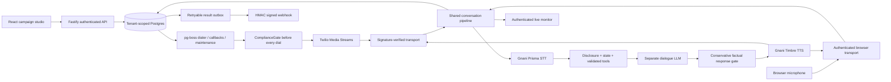

# ElevateBox Campaign Studio

For a Render deployment, use the [Render deployment guide](deploy/render/README.md)
and the root `render.yaml` Blueprint. The repository already follows an
`apps/` + `packages/` monorepo layout; deploy it from this Git root.

The app has a public landing page and a signed-in workspace for sales, marketing, customer care, recruitment, and appointments. It includes a campaign builder, browser test, phone-call panel, and saved conversation results. See the [frontend guide](docs/FRONTEND_REFRESH.md) and [screenshots](docs/screens-refresh/README.md).

Configure sales and HR calling campaigns with Gnani Prisma speech recognition, Gnani Timbre voice, and a separately configured dialogue LLM. The persistent server serves the React app, browser audio, Twilio Media Streams, authenticated APIs and a Postgres-backed queue.

**Build status:** working local application and explicit offline simulation; live Gnani/Twilio verification and public staging deployment require account credentials. This is not yet certified as production ready. See [TODO_FOR_HUMAN.md](TODO_FOR_HUMAN.md).

## What is real / what is simulated

| Capability | Repository implementation | Verified status |
|---|---|---|
| Campaign UI, auth, CSV mapping/export, settings, results | React + Fastify | Local browser/DB tests |
| Persistence, tenant isolation, suppression, jobs, result outbox | Postgres + Drizzle + pg-boss | Local integration tests |
| Gnani Prisma streaming STT | Documented headers, paced PCM frames, endpoint events | Local protocol mock; live NOT RUN |
| Gnani Timbre v3.0 SSE TTS | Documented voice catalog, raw 8 kHz mu-law | HTTP protocol mock; live NOT RUN |
| Dialogue | Groq Qwen 3.8 27B text streaming by default, behind `DialogueClient` | Mock tests; live NOT RUN |
| Browser test call | Microphone PCM -> same conversation pipeline -> browser audio | Simulation/handshake tested; live audio NOT RUN |
| Twilio voice, AMD, status, media | Signature checks, call/stream IDs, media/mark/clear | Synthetic Media Streams; real calls NOT RUN |
| Webhook submission | Signed HTTPS, durable outbox, retry/dead letter/idempotency | Mock delivery tests; real receiver NOT RUN |
| Sample data | Fictional companies and reserved synthetic numbers, tagged `sample` | Explicit simulations, excluded from real metrics |
| Fly image and deployment config | One always-on container; release migration | Local Docker build/smoke; public deploy NOT RUN |

Gnani supplies speech in this custom pipeline; it does **not** decide the dialogue. The UI always names the configured text model. Current Gnani docs also describe Agent Builder APIs, but this application does not use those agents or claim Evon integration. The challenge excludes Agent Builder; see [official contest check](docs/CONTEST_RULES.md).

## Local setup (PowerShell)

Requires Node 22+, Docker and pnpm 10.28.0. Docker Compose uses port 54329 for local Postgres.

```powershell
corepack enable
corepack prepare pnpm@10.28.0 --activate
pnpm install --frozen-lockfile
docker compose up -d postgres
Copy-Item .env.example .env
# Edit .env: set MOCK_MODE=true, SEED_ADMIN_EMAIL, and a 12+ character
# SEED_ADMIN_PASSWORD. Keep the example's local DATABASE_URL and PUBLIC_BASE_URL.
pnpm db:migrate
pnpm seed
pnpm build
pnpm start
```

Open http://localhost:3000 and choose **Sign in** with the `SEED_ADMIN_EMAIL` and `SEED_ADMIN_PASSWORD` you set. `pnpm seed` creates fictional sales and HR campaigns and synthetic results; it requires `MOCK_MODE=true`. Offline mode shows a simulation banner and uses **silent mock TTS** plus scripted text input. It is never described as a live Gnani call. `pnpm dev` watches the server; `pnpm dev:web` starts Vite separately (for authenticated WebSockets, use the configured same-origin production build).

For a container-only local setup, run `docker compose up --build -d`, then `docker compose exec app node scripts/dist/seed.js`. Docker Compose supplies the development-only default account `demo@example.test` / `local-demo-passphrase`; override it before any public deployment. Production requires HTTPS and a 32+ character session secret. Do not publish development credentials.

## Use the workspace

1. Sign in, then choose a workflow from **Workspace**. The five cards open an agent setup flow; **Campaigns** also offers the sales and HR campaign builder.
2. Enter the approved company or role details, select questions and languages, and review the agent preview. Use synthetic or consented contacts for tests.
3. In offline mode, run a browser simulation and inspect the saved result in **Conversations**. Sample results are labelled and excluded from live metrics.
4. Open **Settings > Connections** to see which live services have credentials configured. This does not verify provider health. For real browser or phone calls, set `MOCK_MODE=false` and supply Gnani STT/TTS and Groq credentials. Phone calls also need Twilio credentials and an internet-reachable HTTPS `TWILIO_WEBHOOK_BASE_URL` that forwards voice, status, and WebSocket media to the server. Keep `PUBLIC_BASE_URL` as the dashboard origin. Follow the [live calling guide](docs/LIVE_CALLING.md) before dialing.

## Architecture



Active audio is pinned to one long-running process. Durable data survives process restart; an active conversation does not. Vercel functions are no longer the runtime. Original source remains in Git history; unmounted routes and diagnostic scripts were removed from the current tree. Legacy resume sharing is removed and `public/` is never served.

## Verification and screenshots

```powershell
pnpm typecheck
pnpm lint
pnpm test
pnpm build
pnpm test:e2e # run server in explicit MOCK_MODE=true first
pnpm smoke
pnpm exec tsx scripts/loadtest-media.ts # explicit MOCK_MODE=true, dedicated local test database
```

The test database must be local/dedicated. Set `TEST_DATABASE_URL` as documented in `.env.example`. Tests create isolated tenant IDs and remove only their own records. [Evaluation and actual measurement limits](docs/EVAL.md) describe the test evidence. Live LLM evaluation is **not run**. No live hallucination, latency, cost or concurrency benchmark is claimed.


## Safety and limitations

- AI disclosure is mandatory. Recording is disabled. DND writes suppression synchronously; retries must pass the same gate.
- Calling windows are inside 09:00-21:00 Asia/Kolkata. Consent/registration/DLT/NCPR/TRAI obligations remain the operator's responsibility. This app does not scrub the national registry.
- Approved campaign facts and job-related questions constrain the agent. An extractive gate rejects novel factual sentences; supply approved native-script material for other languages. This conservative choice can produce more follow-up responses and less fluent paraphrasing. Live review is still required.
- HR screening is advisory, with deterministic exact-answer criteria. Sensitive utterances are filtered conservatively; no filter can promise comprehensive sensitive-data removal. Humans make hiring decisions.
- Sample/simulated results are separated from live analytics. Costs are operator-rate estimates, never billed amounts. Raw provider token usage can be unavailable.
- Session cookies, CSRF, roles, login throttling, webhook signatures, public-address-pinned webhook delivery and masked logging are implemented. Further external security review is required before commercial use.
- Retention defaults to 30 days for calls/results/deliveries. Contacts and suppression require explicit deletion. Read [API.md](docs/API.md) for export/delete endpoints.
- Single-machine live monitor only. No multi-machine fan-out, Google Sheets adapter, warm transfer, WhatsApp/SMS follow-up, automatic FAQ generation, acoustic VAD latency benchmark or production restore drill is claimed. Browser capture uses a supported but deprecated ScriptProcessor API; a production AudioWorklet is a follow-up improvement.
- List APIs currently bound responses to 5,000 rows. Add pagination/SQL aggregation before operating above that volume. User administration is seeded/read-only in the UI. The default admin password seed does not reset existing accounts.

## Handoff

[Audit](docs/AUDIT.md) | [Decisions](docs/DECISIONS.md) | [Deployment](docs/DEPLOY.md) | [Runbook](docs/RUNBOOK.md) | [API](docs/API.md) | [Evaluation](docs/EVAL.md) | [Contest submission](docs/SUBMISSION.md) | [Demo script](docs/DEMO_SCRIPT.md) | [Human setup checklist](TODO_FOR_HUMAN.md)

## Credits and contributions

Original prototype: [Ujjwalkr0001/AI_PhoneCaller](https://github.com/Ujjwalkr0001/AI_PhoneCaller), README title "ElevateBox AI Caller". Original cascaded architecture, provider wrappers, callback parser and barge-in/sentence/silence concepts informed this upgrade. Gnani AI provides Prisma and Timbre APIs. Twilio provides telephony. The separate dialogue provider must always be credited accurately.

| Team member | Contribution | Verification |
|---|---|---|
| Ujjwal (repository owner; confirm display name) | Original prototype and repository ownership | Confirm exact scope before submission |
| Codex (AI engineering assistance; not a human team member) | Workspace migration, pipeline, providers, API/UI, tests and operational artifacts in this branch | Git commits and tests |
| Other human team members - fill one row each | Human must supply names and actual contributions | Do not invent participation |

The team must complete the contribution table and verify every contest claim before submitting. No public contest posts or form submissions were made by this build.
